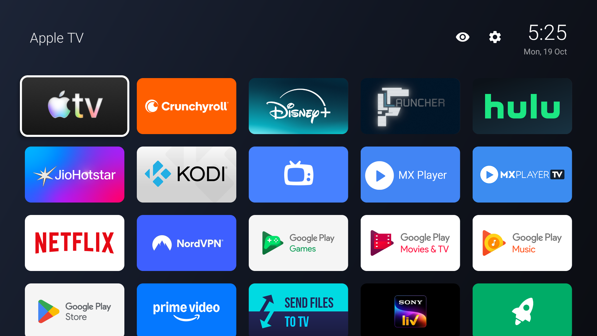

# MiTV Lite Launcher

A tiny, fast, ad-free home screen for Xiaomi Mi TV (developed and tested on a Mi TV running Android 9). Built for low-RAM TVs where PatchWall and the Google TV launcher lag.



|            | Google TV launcher | FLauncher | **MiTV Lite Launcher** |
|------------|-------------------:|----------:|---------------------:|
| APK size   | —                  | 26 MB     | **~44 KB**           |
| RAM (PSS)  | ~164 MB            | ~43 MB    | **~22 MB**           |

Plain Android Views + Kotlin. No AndroidX, no libraries, no network access, no tracking.

## Features

- Grid of app banners with focus zoom; fixed tile size, shrinks only when apps no longer fit one screen (no scrolling)
- Clock and date, Wi-Fi indicator
- Long-press an app: **Move**, **Hide**, **App info**, **Uninstall**
- Move mode: arrows shift the tile, OK saves
- Hidden apps list (eye icon) to bring apps back
- Now-playing bar for Spotify (title, artist, cover, previous / play-pause / next) in the header; appears only while Spotify has a session
- Settings shortcut (gear icon)
- Updates automatically when apps are installed or removed
- Android 5.0+ (API 21); tested on Xiaomi Mi TV (Android 9)

## Install

**Easiest:** follow the [Setup guide](GUIDE.md): one command installs the launcher and debloats the TV (reversible).

Manual steps:

1. On the TV, enable **Developer options** (Settings → Device Preferences → About → click *Build* 7 times), then turn on **USB debugging** / network debugging.
2. Download the APK from the [Releases page](../../releases) (or build it yourself) and install it:

   ```bash
   adb connect <TV_IP>:5555
   adb install mitv-lite-launcher-v1.0.apk
   adb shell cmd package set-home-activity dev.lite.launcher/.MainActivity
   ```

3. Press Home on the remote.

### Optional: disable the stock launcher

Install and test MiTV Lite Launcher **first**. Disabling every home app leaves the TV with a black screen.

```bash
# find home apps
adb shell cmd package query-activities --brief -a android.intent.action.MAIN -c android.intent.category.HOME

# Android TV home / Google TV home / Xiaomi PatchWall
adb shell pm disable-user --user 0 com.google.android.tvlauncher
adb shell pm disable-user --user 0 com.google.android.apps.tv.launcherx
adb shell pm disable-user --user 0 com.mitv.tvhome.atv
```

Undo with `adb shell pm enable <package>`.

## Build

Requires JDK 17+ and the Android SDK.

```bash
./gradlew assembleRelease
adb install -r app/build/outputs/apk/release/app-release.apk
```

Release builds are signed with your debug key unless these are set in `~/.gradle/gradle.properties`:

```properties
liteStoreFile=/path/to/release.jks
liteStorePassword=...
liteKeyAlias=...
liteKeyPassword=...
```
